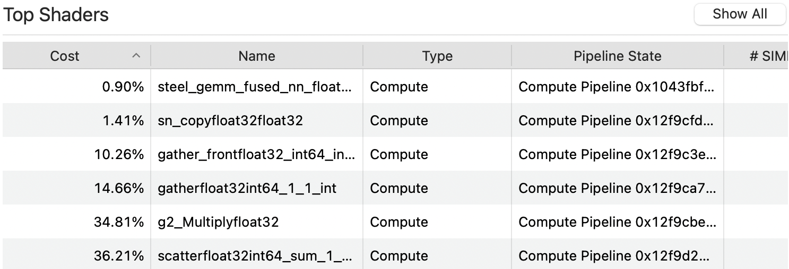

```{=html}
<style>
/* Scoped to .fmp so nothing leaks into the rest of the site. */
.fmp{
  --fmp-ink:#1d1c1a; --fmp-ink-2:#55524b; --fmp-ink-3:#86827a;
  --fmp-bg:#ffffff; --fmp-surface:#f3f2ee; --fmp-rule:#e2e0da;
  --gather:#2a78d6; --coo:#eb6834; --csr:#1baf7a; --hub:#c2332a;
  --fmp-mono: var(--bs-font-monospace, ui-monospace, SFMono-Regular, Menlo, monospace);
}
body.quarto-dark .fmp{
  --fmp-ink:#ecebe7; --fmp-ink-2:#b5b2aa; --fmp-ink-3:#85827b;
  --fmp-bg:#222222; --fmp-surface:#2b2b2a; --fmp-rule:#3a3935;
  --gather:#3987e5; --coo:#d95926; --csr:#199e70; --hub:#e5675d;
}
.fmp{margin:1.5rem 0 2rem}
.fmp svg text{font-family:var(--fmp-mono)}
.fmp .wide{width:100%;height:auto;display:block}
.fmp code{background:rgba(127,127,127,.16);color:inherit;padding:.1em .3em;border-radius:4px;font-size:.88em}
.fmp .fmp-cap{font-size:.9rem;color:var(--fmp-ink-2);margin-top:.6rem;line-height:1.5}
.fmp .stats{display:grid;grid-template-columns:repeat(auto-fit,minmax(9rem,1fr));gap:1rem}
.fmp .stat{background:var(--fmp-surface);border-radius:10px;padding:1rem}
.fmp .stat b{display:block;font-size:2rem;line-height:1;font-weight:700;margin-bottom:.35rem;color:var(--fmp-ink)}
.fmp .stat span{font-size:.88rem;color:var(--fmp-ink-2);line-height:1.35;display:block}
.fmp table{border-collapse:collapse;width:100%;font:400 .85rem/1.4 var(--fmp-mono);margin:0 0 1rem;color:var(--fmp-ink)}
.fmp th,.fmp td{padding:.45rem .5rem;border-bottom:1px solid var(--fmp-rule);text-align:right}
.fmp th:first-child,.fmp td:first-child{text-align:left}
.fmp th{color:var(--fmp-ink-2);font-weight:600}
.fmp .chart{background:var(--fmp-surface);border-radius:12px;padding:1.1rem 1.1rem .8rem}
.fmp .chart-head{display:flex;justify-content:space-between;align-items:baseline;gap:1rem;flex-wrap:wrap;margin-bottom:.4rem}
.fmp .chart-title{font-weight:600;font-size:1rem;color:var(--fmp-ink)}
.fmp .chart-sub{font-size:.82rem;color:var(--fmp-ink-2)}
.fmp .legend{display:flex;gap:1rem;font:400 .78rem var(--fmp-mono);color:var(--fmp-ink-2);margin:.3rem 0 .6rem;flex-wrap:wrap}
.fmp .legend i{display:inline-block;width:.75rem;height:.75rem;border-radius:3px;margin-right:.35rem;vertical-align:-1px}
.fmp .toggle{font:400 .75rem var(--fmp-mono);background:none;border:1px solid var(--fmp-rule);color:var(--fmp-ink-2);border-radius:6px;padding:.25rem .55rem;cursor:pointer}
.fmp .toggle:hover{color:var(--fmp-ink)}
.fmp-tip{position:fixed;pointer-events:none;background:var(--fmp-ink);color:var(--fmp-bg);font:400 .78rem/1.4 var(--fmp-mono);padding:.45rem .6rem;border-radius:6px;opacity:0;transition:opacity .08s;z-index:1100;white-space:nowrap}
.fmp .bar{transition:opacity .1s}
.fmp .chart svg:hover .bar{opacity:.45}
.fmp .chart svg .bar:hover{opacity:1}
.fmp .d-ink{fill:var(--fmp-ink)} .fmp .d-ink2{fill:var(--fmp-ink-2)} .fmp .d-ink3{fill:var(--fmp-ink-3)}
.fmp .d-box{fill:var(--fmp-bg);stroke:var(--fmp-rule);stroke-width:1.5}
.fmp .d-line{stroke:var(--fmp-ink-3);stroke-width:1.5;fill:none}
.fmp .d-gather{fill:var(--gather)} .fmp .d-coo{fill:var(--coo)} .fmp .d-csr{fill:var(--csr)} .fmp .d-hub{fill:var(--hub)}
.fmp .s-gather{stroke:var(--gather)} .fmp .s-coo{stroke:var(--coo)} .fmp .s-csr{stroke:var(--csr)} .fmp .s-hub{stroke:var(--hub)}
</style>
```

::: {.callout-note appearance="simple"}
## TL;DR

- GNN layers in mlx-graphs used to copy a feature row for *every edge* and then scatter them back. We fused that into one sparse matrix multiply (SpMM) kernel in mlx-cluster, with a full backward pass.
- Two layouts: **COO** (one thread per edge, atomics) and **CSR** (one thread per destination row, no atomics, deterministic).
- On an M4 Pro, CSR runs a 1M-edge layer about **2–8× faster** than the old path and uses up to **15× less memory**.
- On an M1 with a power-law graph, CSR is up to **93× faster**. The reason is that it never needs a floating-point atomic, and on the M1 those get very slow when many threads hit the same "hub" node.
- The same lesson fixed one last slow spot: node degrees are now counted with integer atomics instead of float ones.
:::

## The problem: one copy per edge

Almost every GNN layer does the same thing. For each node, look at its neighbours, take their features (maybe scaled by an edge weight), and combine them with a sum, mean, max or min. In mlx-graphs this was written in the most direct way possible:

```python
msgs = x[src]                 # gather:  [E, D] — one row per edge
msgs = msgs * w[:, None]      # multiply (optional edge weight)
out  = scatter_add(msgs, dst) # scatter: [N, D]
```

It's easy to read, but the middle array has one row for every *edge*, not every node. A graph with 1M edges and 64 features makes a 256 MB temporary, and autograd keeps a few more of those around for the backward pass. All of it is written to memory and then read back once.

That was the motivation for [mlx-graphs issue #26](https://github.com/mlx-graphs/mlx-graphs/issues/26). The three steps together are just a sparse matrix times a dense matrix, `out = A @ X`, where `A` is the adjacency matrix. A dedicated kernel can read each neighbour's row and add it straight into the output, so the `[E, D]` array never exists.

```{=html}
<div class="fmp">
<svg class="wide" viewBox="0 0 680 230" role="img" aria-label="Gather-scatter versus fused SpMM data flow">
  <defs><marker id="fmp-arr" viewBox="0 0 10 10" refX="9" refY="5" markerWidth="7" markerHeight="7" orient="auto"><path d="M0 0 L10 5 L0 10z" class="d-ink3"/></marker></defs>
  <text x="10" y="20" class="d-ink" font-size="13" font-weight="600">Before: gather → multiply → scatter</text>
  <rect x="10" y="35" width="90" height="50" rx="6" class="d-box"/><text x="55" y="65" text-anchor="middle" class="d-ink" font-size="12">X [N,D]</text>
  <rect x="150" y="35" width="130" height="50" rx="6" class="d-gather" opacity=".18"/><rect x="150" y="35" width="130" height="50" rx="6" fill="none" class="s-gather" stroke-width="1.5"/>
  <text x="215" y="58" text-anchor="middle" class="d-ink" font-size="12">msgs [E,D]</text><text x="215" y="74" text-anchor="middle" class="d-ink2" font-size="10">256 MB @1M×64</text>
  <rect x="330" y="35" width="130" height="50" rx="6" class="d-gather" opacity=".18"/><rect x="330" y="35" width="130" height="50" rx="6" fill="none" class="s-gather" stroke-width="1.5"/>
  <text x="395" y="58" text-anchor="middle" class="d-ink" font-size="12">msgs·w [E,D]</text><text x="395" y="74" text-anchor="middle" class="d-ink2" font-size="10">another 256 MB</text>
  <rect x="510" y="35" width="90" height="50" rx="6" class="d-box"/><text x="555" y="65" text-anchor="middle" class="d-ink" font-size="12">out [N,D]</text>
  <path d="M100 60 H146" class="d-line" marker-end="url(#fmp-arr)"/><path d="M280 60 H326" class="d-line" marker-end="url(#fmp-arr)"/><path d="M460 60 H506" class="d-line" marker-end="url(#fmp-arr)"/>
  <text x="123" y="52" text-anchor="middle" class="d-ink3" font-size="10">gather</text><text x="303" y="52" text-anchor="middle" class="d-ink3" font-size="10">mul</text><text x="483" y="52" text-anchor="middle" class="d-ink3" font-size="10">scatter</text>
  <text x="10" y="140" class="d-ink" font-size="13" font-weight="600">After: one SpMM kernel</text>
  <rect x="10" y="155" width="90" height="50" rx="6" class="d-box"/><text x="55" y="185" text-anchor="middle" class="d-ink" font-size="12">X [N,D]</text>
  <rect x="200" y="155" width="270" height="50" rx="6" class="d-csr" opacity=".18"/><rect x="200" y="155" width="270" height="50" rx="6" fill="none" class="s-csr" stroke-width="1.5"/>
  <text x="335" y="178" text-anchor="middle" class="d-ink" font-size="12">spmm(A, X)</text><text x="335" y="194" text-anchor="middle" class="d-ink2" font-size="10">reads neighbours, adds in registers</text>
  <rect x="510" y="155" width="90" height="50" rx="6" class="d-box"/><text x="555" y="185" text-anchor="middle" class="d-ink" font-size="12">out [N,D]</text>
  <path d="M100 180 H196" class="d-line" marker-end="url(#fmp-arr)"/><path d="M470 180 H506" class="d-line" marker-end="url(#fmp-arr)"/>
</svg>
<div class="fmp-cap">The fused kernel never materialises anything of size E×D. The only extra memory is the index arrays, which you already have.</div>
</div>
```

## Two ways to store a graph: COO and CSR

The issue mentioned a CUDA example (PyG's `torch_sparse`) and the COO format. These are just two ways to write down the same edges.

**COO** (coordinate) is two parallel lists, `row` and `col`, one entry per edge. It's what `edge_index` already is. **CSR** (compressed sparse row) sorts edges by destination and replaces the `row` list with a short `rowptr` array: node `i`'s neighbours live at `col[rowptr[i] : rowptr[i+1]]`.

```{=html}
<div class="fmp">
<svg class="wide" viewBox="0 0 680 250" role="img" aria-label="Small graph in COO and CSR form">
  <g font-size="12">
    <line x1="60" y1="70" x2="150" y2="70" class="d-line"/><line x1="60" y1="70" x2="105" y2="160" class="d-line"/>
    <line x1="150" y1="70" x2="105" y2="160" class="d-line"/><line x1="105" y1="160" x2="190" y2="200" class="d-line"/>
    <circle cx="60" cy="70" r="16" class="d-box"/><text x="60" y="74" text-anchor="middle" class="d-ink">0</text>
    <circle cx="150" cy="70" r="16" class="d-box"/><text x="150" y="74" text-anchor="middle" class="d-ink">1</text>
    <circle cx="105" cy="160" r="20" class="d-hub" opacity=".2"/><circle cx="105" cy="160" r="20" fill="none" class="s-hub" stroke-width="1.5"/><text x="105" y="164" text-anchor="middle" class="d-ink">2</text>
    <circle cx="190" cy="200" r="16" class="d-box"/><text x="190" y="204" text-anchor="middle" class="d-ink">3</text>
    <text x="20" y="235" class="d-ink3" font-size="10">node 2 has the most neighbours</text>
  </g>
  <text x="250" y="40" class="d-ink" font-size="13" font-weight="600">COO  (dst, src)</text>
  <g font-size="12">
    <text x="250" y="70" class="d-ink2">row</text><text x="250" y="100" class="d-ink2">col</text>
    <g transform="translate(290,52)"><g id="fmp-coo-cells"></g></g>
  </g>
  <text x="250" y="150" class="d-ink" font-size="13" font-weight="600">CSR</text>
  <g font-size="12">
    <text x="250" y="180" class="d-ink2">rowptr</text><text x="250" y="210" class="d-ink2">col</text>
    <g transform="translate(305,162)" id="fmp-csr-cells"></g>
  </g>
</svg>
<div class="fmp-cap">Same 8 directed edges (each undirected edge stored both ways). In CSR, destination 2's neighbours are the contiguous slice <code>col[4:7]</code>, so one thread can own that whole row.</div>
</div>
```

The format decides how you parallelise the GPU work, and that turned out to be the most important choice in the whole project:

- **COO kernel:** one thread per edge. Each thread reads `x[src]` and adds it into `out[dst]`. Many edges share a `dst`, so those adds have to be *atomic*.
- **CSR kernel:** one thread (group) per destination row. It loops over that row's neighbours, sums in registers, and writes `out[i]` exactly once. No other thread touches that row, so no atomics are needed and the result is the same every run.

## The kernels, and why we had to write a backward pass

MLX lets an extension define a *Primitive*: a class with a CPU implementation, a Metal (GPU) implementation, and the derivative rules. We built one `SpMM` primitive in mlx-cluster that covers both layouts, optional edge weights, and sum/mean/max/min.

Training needs gradients, and MLX can't differentiate through a hand-written kernel on its own. So we wrote the rules ourselves:

- **Gradient for X:** if `out = A @ X` then `dX = Aᵀ @ dOut`. That's another SpMM, just with the edges reversed.
- **Gradient for edge weights:** `dw[e] = dot(dOut[dst], X[src])`, one dot product per edge. This is called SDDMM, and it got its own small kernel.

On the mlx-graphs side, a `@fused_message_passing` decorator lets a layer opt in. When the layer's message is the standard "neighbour features × optional weight" pattern, `propagate()` skips gather/scatter and calls the kernel. Anything else (attention softmax, GINE's edge MLP) falls back to the old path automatically. GCN, SAGE, GIN and SimpleConv are decorated today.

## What the GPU trace says

Benchmarks tell you *how much* faster something is. A GPU trace tells you *why*. We recorded Metal GPU traces in Xcode of the same work on all three paths: `GCNConv` on `powerlaw-1m` with 64 features, two training steps (forward and backward), on an Apple M4 Pro. These traces use the final kernels, including the two CSR improvements described in the next sections.

| | Old path (gather) | COO kernel | CSR kernel |
|---|---:|---:|---:|
| GPU time | 28.97 ms | 4.97 ms (5.8× less) | 3.92 ms (7.4× less) |
| GPU memory | 642.86 MiB | 186.64 MiB (3.4× less) | 251.03 MiB (2.6× less) |
| Command buffers | 14 | 2 | 2 |
| Compute encoders | 13 | 1 | 1 |
| Dispatch calls | 32 | 20 | 20 |

{#fig-trace-summary fig-alt="Three Xcode GPU trace summary panels side by side. Old path: 14 command buffers, 13 compute encoders, 32 dispatch calls, 28.97 ms GPU time, 641.86 MiB of buffers. COO kernel: 2 command buffers, 1 compute encoder, 20 dispatch calls, 4.97 ms, 185.64 MiB. CSR kernel: 2 command buffers, 1 compute encoder, 20 dispatch calls, 3.92 ms, 250.03 MiB."}

### Where the old path's time goes

On the old path, four kernels take **96%** of the GPU time: the scatter-add (36.2%), the multiply by edge weights (34.8%) and two gathers (14.7% and 10.3%). These are exactly the kernels that create, scale and sum up the `[E, D]` per-edge arrays. The layer's actual matrix multiply (`steel_gemm`, the linear projection) takes **0.9%**.

{#fig-trace-shaders fig-alt="Xcode Top Shaders table for the gather trace: scatterfloat32int64_sum 36.21%, g2_Multiplyfloat32 34.81%, gatherfloat32int64 14.66%, gather_frontfloat32_int64 10.26%, sn_copyfloat32float32 1.41%, steel_gemm_fused_nn_float 0.90%."}

Each of those kernels does almost no arithmetic: one multiply or one add per number it reads and writes. Xcode's counters agree. Per encoder, instruction throughput utilisation stays between about 3% and 23%, so the compute units spend most of their time waiting for data. The work is limited by **memory traffic**, so the way to speed it up is to move fewer bytes, not to compute faster. That's exactly what fusing does.

Two more details stand out:

- **13 encoders down to 1.** Because the old path moves hundreds of megabytes per step, MLX splits its work into many separate batches, with idle gaps in between. The fused paths fit both training steps into a single encoder.
- **CSR uses more memory than COO** (251 vs. 187 MiB). CSR keeps extra index arrays: the sorted copy of the graph, its transpose for the backward pass, and the long-row chunk tables. It still uses 2.6× less memory than the old path.

### A profiling lesson

Our first CSR traces were misleading. They showed only the COO kernel, and CSR looked no better than COO. Two things combined. Our capture script asked MLX for the gradient alone (`mx.grad`), and for that loss MLX could skip the forward pass entirely, so the forward CSR kernel never ran. And at that point, CSR's backward pass still used the COO kernel. Switching the capture to `mx.value_and_grad`, which forces both passes, fixed the first problem. The next two sections fix CSR itself.

## The power-law surprise

Real graphs aren't uniform. Citation networks, social graphs and the web follow a **power law**: most nodes have a handful of neighbours, and a few "hubs" have an enormous number. Our synthetic `powerlaw-1m` benchmark graph has exactly that shape: its busiest node has about **134,000** incoming edges.

The naive CSR kernel assigns one thread per row. A GPU kernel only finishes when its *slowest* thread finishes. So while almost every thread finishes after a few neighbours, the hub's thread walks through its 134,000 neighbours one by one, and the whole kernel waits for it.

```{=html}
<div class="fmp">
<svg class="wide" viewBox="0 0 680 320" role="img" aria-label="Load imbalance: one thread per row versus chunked long rows">
  <text x="10" y="20" class="d-ink" font-size="13" font-weight="600">Naive CSR: one thread per row</text>
  <g id="fmp-naive"></g>
  <text x="10" y="185" class="d-ink" font-size="13" font-weight="600">With long-row chunking</text>
  <g id="fmp-chunked"></g>
  <text x="670" y="20" text-anchor="end" class="d-ink3" font-size="10">← time →</text>
</svg>
<div class="fmp-cap">Each bar is one thread's work (schematic). Without chunking, the hub row (red) sets the runtime for the whole kernel. With chunking, the hub is split into 2048-edge pieces that run in parallel, then a small second kernel adds the pieces up in a fixed order.</div>
</div>
```

### The fix: split long rows

When the CSR structure is built (once, then cached), we find every row with more than 256 neighbours and cut it into chunks of 2048 edges. Short rows still use the simple one-thread-per-row kernel. Long rows go through two extra kernels: a *partial* kernel where each chunk sums its piece in parallel, and a *reduce* kernel that adds the chunk results in a fixed order. For the biggest hub in `powerlaw-1m`, that's about 66 chunks working at once instead of one thread doing all 134,000 edges.

There's an accuracy bonus too. Adding 134,000 floats one after another builds up rounding error, because each new value is added to an ever-larger running total. Summing 2048 at a time and then combining the totals keeps those errors smaller.

## A deterministic backward pass

The backward pass needs `Aᵀ @ dOut`. At first we ran it with the COO kernel and swapped indices, which put the atomics back. So we also build a **transposed CSR** (edges grouped by source instead of destination), with its own long-row chunks. Now the backward is also one-thread-per-row, atomic-free and gives the same answer every run.

The API stays flexible: you can still call the COO path at any time (no preprocessing needed), and CSR is an option that pays a one-time build cost which the decorator caches per graph.

## Max and min without storing an argmax

Sum is easy. Max and min needed two tricks.

**Forward (COO):** Metal has no atomic float max. It does have atomic *integer* max. We use a standard bit trick that maps each float to an unsigned integer whose ordering matches the float ordering (flip the sign bit for positives, flip all the bits for negatives). Then `atomic_fetch_max` on the integers gives the float max, and a small decode kernel turns them back into floats.

**Backward:** the gradient flows only to the neighbour that "won" the max. Instead of saving an argmax array during the forward pass, the backward kernel recomputes it: for each edge, check whether `x[src] == out[dst]`. Ties get the full gradient, which matches what MLX's own scatter-max does, and empty rows output 0.

That integer-atomic detail matters for the M1 story below.

## Results on an M4 Pro

Every number below is forward + backward (`value_and_grad`), median time, on the synthetic power-law graph with 1M edges and 256 features. GAT is included as a control: its attention softmax isn't fusable, so all three modes should match, and they do.

```{=html}
<div class="fmp">
<div class="chart" id="fmp-c-m4"></div>
<div class="fmp-cap">M4 Pro, <code>powerlaw-1m</code>, D=256. Lower is better.</div>
</div>
<div class="fmp">
<div class="chart" id="fmp-c-mem"></div>
<div class="fmp-cap">Peak memory during forward + backward, same graph. Max and min benefit most because the old path also kept a large argmax buffer.</div>
</div>
```

Two things stand out. First, CSR beats COO even on the M4 Pro, by about 1.5–2× on the plain aggregations. Second, the memory savings are large and they hold for COO and CSR alike, because both remove the `[E, D]` arrays. On tiny graphs like Cora, the difference is just a fraction of a millisecond either way, since per-call overhead dominates there.

## Results on an 8 GB M1, and why CSR loves power laws

Then we ran the same benchmark on an M1 MacBook with 8 GB, and the gap got much bigger.

```{=html}
<div class="fmp">
<div class="stats">
  <div class="stat"><b>93×</b><span>CSR vs old path, mean aggregation, <code>powerlaw-1m</code> D=16</span></div>
  <div class="stat"><b>48×</b><span>SAGEConv with CSR, same graph</span></div>
  <div class="stat"><b>~1×</b><span>COO sum vs old path on the same graph. Float atomics are the bottleneck</span></div>
  <div class="stat"><b>15×</b><span>less peak memory for max/min</span></div>
</div>
</div>
<div class="fmp">
<div class="chart" id="fmp-c-m1"></div>
<div class="fmp-cap">M1 (8 GB), <code>powerlaw-1m</code>, D=16, forward + backward, measured before the integer degree fix described in the last section. Note how COO sum barely beats the old path while COO max (integer atomics) is already fast.</div>
</div>
```

### So why is CSR so good on power-law graphs?

Take the busiest node in `powerlaw-1m`, with about 134,000 incoming edges. With 16 features, that means about 2.1 million additions that all land in the same 16 output slots.

```{=html}
<div class="fmp">
<svg class="wide" viewBox="0 0 680 300" role="img" aria-label="Atomic contention at a hub versus CSR row ownership">
  <text x="10" y="20" class="d-ink" font-size="13" font-weight="600">Gather / COO: all edges hit out[hub]</text>
  <g id="fmp-contend"></g>
  <text x="360" y="20" class="d-ink" font-size="13" font-weight="600">CSR: the hub's chunks sum privately</text>
  <g id="fmp-own"></g>
</svg>
<div class="fmp-cap">Left: thousands of threads issue an atomic float add to the same address, and the hardware handles them one at a time. Right: each chunk adds in its own registers, and only a handful of partial sums meet at the end, in a fixed order.</div>
</div>
```

Here is what each path does with that hub:

- **Old path (gather + `scatter_add`):** MLX's scatter uses a float atomic add per element. All of those adds target the same 16 addresses, so they queue up. On top of that it moves the full `[E, D]` array through memory.
- **COO kernel:** it removes the big array, but it still issues one float atomic per edge per feature into the hub's row. The queue is just as long. That's why COO sum on the M1 is about 72 ms against 77 ms for the old path: it fixed the memory traffic but not the bottleneck.
- **CSR kernel:** no atomics at all. The hub's 134,000 edges are split into about 66 chunks of 2048. Each chunk sums into registers that no other thread can see, and a tiny reduce kernel adds the 66 partial results. There is no queue: 2.3 ms.

::: {.callout-tip}
## The clue that proves it

On the M1, COO *max* takes 5 ms while COO *sum* takes 72 ms on the same graph. Both use one atomic per edge into the same hub. The only difference is that max uses *integer* atomics (thanks to the bit trick) and sum uses *float* atomics. Contended integer atomics are fine on the M1. Contended float atomics are the problem.
:::

### Why the M4 Pro hides this

Newer Apple GPUs handle contended float atomics much better and have more memory bandwidth, so on the M4 Pro COO only trails CSR by about 2×. The M1 shows the worst case, and its 8 GB of unified memory makes the old path's big temporary arrays hurt more too. On uniform graphs (no hubs) the M1 gap shrinks back to roughly 2–5×. So the power-law gap is mostly about contention, not raw speed.

Mean aggregation was the most extreme case (93×) because both the old path and COO computed the node degree with another float scatter, which also piled onto the hub. CSR gets degrees for free: `rowptr[i+1] - rowptr[i]`. That observation led to the last fix in this release.

## Accuracy and training

Relative error against the old path stays around 10⁻⁷ to 10⁻⁵ in float32, and max/min match exactly. To make the tests fair, we compare against a float64 reference with a tolerance that scales with the magnitude of the result. A hub that sums 134,000 values will always carry some rounding error, in any implementation. The benchmark folder also has `train_compare.py`, which trains the same model with both paths so you can compare loss curves side by side.

## Counting degrees with integers

The M1 results pointed at one more float-atomic hotspot outside our kernels: **counting each node's neighbours**. Mean aggregation divides a sum by that count, and GCN normalisation uses it too. Both counted by scatter-adding `1.0` per edge, so on `powerlaw-1m` about 134,000 float atomic adds queued on the hub's single counter. That's why COO mean sat at about 253 ms on the M1 (against 72 ms for COO sum), and why `GCNConv` was still about 180 ms even with CSR.

The fix, in this release, is to count with an **int32** scatter and convert to float32 afterwards:

```python
deg = mx.zeros((num_nodes,), dtype=mx.int32).at[index].add(1).astype(mx.float32)
```

- In **mlx-cluster**, `spmm_coo(reduce="mean")` counts this way. `spmm_csr` doesn't need it, because it reads degrees from `rowptr`.
- In **mlx-graphs**, `degree()` counts this way whenever no edge weights are given. That speeds up every caller: mean aggregation on the gather-scatter path, `scatter_max` / `scatter_min` (which use it to find nodes with no neighbours) and unweighted `GCNConv`.
- **Nothing else changes.** Counts are whole numbers, so the int32 result is exact, and the output is still float32. int32 rather than int64, because MLX's GPU scatter doesn't support int64. Converting back to float is one pass over the nodes with no contention, so it costs a fraction of a millisecond.
- Weighted degrees (a sum of edge weights) still use float atomics, since the weights aren't whole numbers.

---

*Numbers come from `benchmarks/spmm/bench_fused_mp.py` in mlx-graphs, run with MLX 0.32.4 on an Apple M4 Pro and an Apple M1 (8 GB). Kernels live in `mlx_cluster/sparse/`. Related issue: [mlx-graphs #26](https://github.com/mlx-graphs/mlx-graphs/issues/26).*

```{=html}
<div class="fmp"><div class="fmp-tip" id="fmp-tip"></div></div>
<script>
(function(){
const NS='http://www.w3.org/2000/svg';
function el(tag,attrs,parent,text){const e=document.createElementNS(NS,tag);for(const k in attrs)e.setAttribute(k,attrs[k]);if(text!=null)e.textContent=text;if(parent)parent.appendChild(e);return e;}

// COO / CSR cells
(function(){
  const row=[0,0,1,1,2,2,2,3], col=[1,2,0,2,0,1,3,2];
  const g=document.getElementById('fmp-coo-cells'); const w=40;
  row.forEach((r,i)=>{
    el('rect',{x:i*w,y:0,width:w-4,height:24,rx:4,class:'d-box'},g);
    if(r===2) el('rect',{x:i*w,y:0,width:w-4,height:24,rx:4,class:'d-hub',opacity:.18},g);
    el('text',{x:i*w+18,y:17,'text-anchor':'middle',class:'d-ink','font-size':12},g,r);
    el('rect',{x:i*w,y:30,width:w-4,height:24,rx:4,class:'d-box'},g);
    el('text',{x:i*w+18,y:47,'text-anchor':'middle',class:'d-ink','font-size':12},g,col[i]);
  });
  const c=document.getElementById('fmp-csr-cells'); const rp=[0,2,4,7,8];
  rp.forEach((v,i)=>{
    el('rect',{x:i*w,y:0,width:w-4,height:24,rx:4,class:'d-box'},c);
    el('text',{x:i*w+18,y:17,'text-anchor':'middle',class:'d-ink','font-size':12},c,v);
  });
  col.forEach((v,i)=>{
    el('rect',{x:i*w-15,y:30,width:w-4,height:24,rx:4,class:'d-box'},c);
    if(i>=4&&i<7) el('rect',{x:i*w-15,y:30,width:w-4,height:24,rx:4,class:'d-hub',opacity:.18},c);
    el('text',{x:i*w+3,y:47,'text-anchor':'middle',class:'d-ink','font-size':12},c,v);
  });
})();

// load imbalance
(function(){
  const lens=[22,35,18,40,28,30,25,600,33,20];
  const g1=document.getElementById('fmp-naive'), g2=document.getElementById('fmp-chunked');
  const x0=80, scale=0.95, h=8, gap=3;
  lens.forEach((L,i)=>{
    const y=32+i*(h+gap), hub=L>100;
    el('text',{x:x0-8,y:y+7,'text-anchor':'end',class:'d-ink3','font-size':9},g1,hub?'hub':'row '+i);
    el('rect',{x:x0,y,width:Math.min(L*scale,585),height:h,rx:3,class:hub?'d-hub':'d-csr'},g1);
  });
  const items=[];
  lens.forEach((L,i)=>{ if(L>100){for(let k=0;k<6;k++)items.push({L:100,hub:true});} else items.push({L,hub:false}); });
  const h2=5.5, gap2=1.8;
  items.forEach((it,i)=>{
    el('rect',{x:x0,y:198+i*(h2+gap2),width:it.L*scale,height:h2,rx:2,class:it.hub?'d-hub':'d-csr'},g2);
  });
  const endY=198+items.length*(h2+gap2);
  el('rect',{x:x0+100*scale+4,y:198+7*(h2+gap2),width:12,height:6*(h2+gap2)-gap2,rx:2,class:'d-ink3',opacity:.5},g2);
  el('text',{x:x0+100*scale+22,y:198+10*(h2+gap2),class:'d-ink3','font-size':9},g2,'+ reduce');
  el('line',{x1:x0+600*scale,y1:28,x2:x0+600*scale,y2:150,class:'d-line','stroke-dasharray':'3 3'},g1);
  el('text',{x:x0+600*scale-4,y:164,'text-anchor':'end',class:'d-ink2','font-size':10},g1,'kernel ends here');
  el('line',{x1:x0+118*scale,y1:194,x2:x0+118*scale,y2:endY,class:'d-line','stroke-dasharray':'3 3'},g2);
  el('text',{x:x0+130*scale,y:endY+12,class:'d-ink2','font-size':10},g2,'kernel ends much sooner');
})();

// contention diagram
(function(){
  const g=document.getElementById('fmp-contend');
  const hx=170, hy=200;
  for(let i=0;i<22;i++){
    const a=Math.PI*(0.08+0.84*i/21), r=135;
    const x=hx-Math.cos(a)*r, y=hy-Math.sin(a)*r*1.15+20;
    el('line',{x1:x,y1:y,x2:hx,y2:hy-14,class:'s-coo','stroke-width':1,opacity:.55},g);
    el('circle',{cx:x,cy:y,r:4,class:'d-coo'},g);
  }
  el('rect',{x:hx-50,y:hy-14,width:100,height:30,rx:6,class:'d-hub',opacity:.2},g);
  el('rect',{x:hx-50,y:hy-14,width:100,height:30,rx:6,fill:'none',class:'s-hub','stroke-width':1.5},g);
  el('text',{x:hx,y:hy+5,'text-anchor':'middle',class:'d-ink','font-size':12},g,'out[hub]');
  el('text',{x:hx,y:hy+40,'text-anchor':'middle',class:'d-ink2','font-size':10},g,'atomic float adds queue up');
  el('text',{x:hx,y:hy+56,'text-anchor':'middle',class:'d-ink2','font-size':10},g,'one at a time');
  const o=document.getElementById('fmp-own'); const ox=380;
  for(let k=0;k<5;k++){
    const x=ox+k*58;
    for(let j=0;j<5;j++) el('circle',{cx:x+8+(j%3)*12,cy:50+Math.floor(j/3)*12+k%2*4,r:3.5,class:'d-csr'},o);
    el('rect',{x:x,y:90,width:44,height:26,rx:5,class:'d-box'},o);
    el('text',{x:x+22,y:107,'text-anchor':'middle',class:'d-ink','font-size':10},o,'Σ'+k);
    el('path',{d:`M${x+22} 116 L${ox+138} 176`,class:'d-line'},o);
  }
  el('text',{x:ox+138,y:80,'text-anchor':'middle',class:'d-ink3','font-size':9},o,'2048-edge chunks, registers only');
  el('rect',{x:ox+88,y:178,width:100,height:30,rx:6,class:'d-csr',opacity:.2},o);
  el('rect',{x:ox+88,y:178,width:100,height:30,rx:6,fill:'none',class:'s-csr','stroke-width':1.5},o);
  el('text',{x:ox+138,y:197,'text-anchor':'middle',class:'d-ink','font-size':12},o,'out[hub]');
  el('text',{x:ox+138,y:240,'text-anchor':'middle',class:'d-ink2','font-size':10},o,'a few ordered adds,');
  el('text',{x:ox+138,y:256,'text-anchor':'middle',class:'d-ink2','font-size':10},o,'no atomics, deterministic');
})();

// bar charts
const tip=document.getElementById('fmp-tip');
const MODES=[['gather','Old path (gather)','--gather'],['coo','COO kernel','--coo'],['csr','CSR kernel','--csr']];
function fmt(v){return v>=100?Math.round(v).toLocaleString():v>=10?v.toFixed(1):v.toFixed(2);}
function barChart(id,{title,sub,unit,cats,data}){
  const root=document.getElementById(id);
  root.innerHTML=`<div class="chart-head"><div><div class="chart-title">${title}</div><div class="chart-sub">${sub}</div></div><button class="toggle">table view</button></div>
  <div class="legend">${MODES.map(m=>`<span><i style="background:var(${m[2]})"></i>${m[1]}</span>`).join('')}</div>`;
  const W=640, labW=78, valW=62, groupH=3*13+2*2+16, H=cats.length*groupH+20;
  const svg=el('svg',{viewBox:`0 0 ${W} ${H}`,class:'wide',role:'img','aria-label':title},root);
  const max=Math.max(...cats.flatMap(c=>MODES.map(m=>data[c][m[0]])));
  const plotW=W-labW-valW;
  const step = max>1000?1000:max>200?100:max>50?20:10;
  for(let v=0;v<=max;v+=step){
    const x=labW+v/max*plotW;
    el('line',{x1:x,y1:0,x2:x,y2:H-18,stroke:'var(--fmp-rule)','stroke-width':1},svg);
    el('text',{x,y:H-4,'text-anchor':'middle',fill:'var(--fmp-ink-3)','font-size':9},svg,v);
  }
  el('text',{x:W-2,y:H-4,'text-anchor':'end',fill:'var(--fmp-ink-3)','font-size':9},svg,unit);
  cats.forEach((c,ci)=>{
    const y0=ci*groupH+4;
    el('text',{x:labW-10,y:y0+24,'text-anchor':'end',fill:'var(--fmp-ink)','font-size':11},svg,c);
    MODES.forEach((m,mi)=>{
      const v=data[c][m[0]], y=y0+mi*15, w=Math.max(2,v/max*plotW);
      const b=el('rect',{x:labW,y,width:w,height:13,rx:4,fill:`var(${m[2]})`,class:'bar'},svg);
      el('rect',{x:labW,y,width:Math.min(4,w),height:13,fill:`var(${m[2]})`,class:'bar','pointer-events':'none'},svg);
      el('text',{x:labW+w+5,y:y+10,fill:'var(--fmp-ink-2)','font-size':10},svg,fmt(v));
      const hit=el('rect',{x:labW,y:y-1,width:plotW+valW,height:15,fill:'transparent'},svg);
      const speed = m[0]==='gather'?'baseline':(data[c].gather/v).toFixed(1)+'× vs old path';
      const show=e=>{tip.innerHTML=`<b>${c}</b> · ${m[1]}<br>${fmt(v)} ${unit} · ${speed}`;tip.style.opacity=1;tip.style.left=(e.clientX+12)+'px';tip.style.top=(e.clientY+12)+'px';b.style.opacity=1;};
      hit.addEventListener('mousemove',show); hit.addEventListener('mouseleave',()=>{tip.style.opacity=0;b.style.opacity='';});
    });
  });
  const tbl=document.createElement('div'); tbl.hidden=true;
  const T='table'; // built as a string so Quarto doesn't try to parse it
  tbl.innerHTML=`<${T}><thead><tr><th>layer</th>${MODES.map(m=>`<th>${m[1]}</th>`).join('')}<th>CSR speedup</th></tr></thead><tbody>${cats.map(c=>`<tr><td>${c}</td>${MODES.map(m=>`<td>${fmt(data[c][m[0]])}</td>`).join('')}<td>${(data[c].gather/data[c].csr).toFixed(1)}×</td></tr>`).join('')}</tbody></${T}>`;
  root.appendChild(tbl);
  const btn=root.querySelector('.toggle');
  btn.onclick=()=>{const t=tbl.hidden;tbl.hidden=!t;svg.style.display=t?'none':'';btn.textContent=t?'chart view':'table view';};
}

barChart('fmp-c-m4',{title:'Forward + backward time, M4 Pro',sub:'powerlaw-1m · 1M edges · D=256',unit:'ms',
  cats:['sum','mean','max','gcn','sage','gin','gat'],
  data:{
    sum:{gather:33.18,coo:17.07,csr:7.94}, mean:{gather:34.52,coo:18.03,csr:8.76},
    max:{gather:69.79,coo:15.78,csr:8.34}, gcn:{gather:54.16,coo:21.69,csr:13.28},
    sage:{gather:47.55,coo:30.07,csr:20.78}, gin:{gather:50.38,coo:32.88,csr:23.64},
    gat:{gather:82.63,coo:82.77,csr:82.66}}});

barChart('fmp-c-mem',{title:'Peak memory, forward + backward, M4 Pro',sub:'powerlaw-1m · 1M edges · D=256',unit:'MB',
  cats:['sum','max','gcn','sage','gin'],
  data:{
    sum:{gather:2156.1,coo:308.3,csr:293.5}, max:{gather:4455.7,coo:308.3,csr:293.5},
    gcn:{gather:2363.8,coo:516.0,csr:508.8}, sage:{gather:2746.8,coo:796.9,csr:782.9},
    gin:{gather:3059.4,coo:1113.9,csr:1099.2}}});

barChart('fmp-c-m1',{title:'Forward + backward time, M1 (8 GB)',sub:'powerlaw-1m · 1M edges · D=16',unit:'ms',
  cats:['sum','mean','max','sage','gcn'],
  data:{
    sum:{gather:76.81,coo:71.89,csr:2.29}, mean:{gather:256.98,coo:253.02,csr:2.76},
    max:{gather:197.70,coo:5.08,csr:3.40}, sage:{gather:258.06,coo:256.31,csr:5.34},
    gcn:{gather:240.62,coo:230.97,csr:182.59}}});
})();
</script>
```
