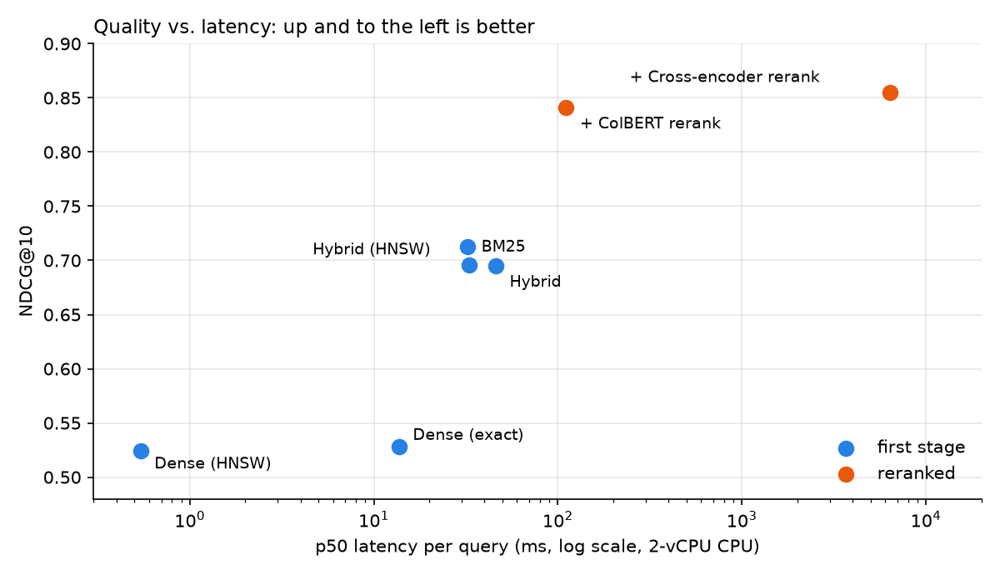

## Introduction

In the [first ScholarSearch post](search_results.qmd) I compared seven retrieval methods
over 194 malware-classification papers and 40 queries. It was a good weekend project, but
it had two problems: the corpus was too small for the numbers to mean much, and every
result came from a pile of one-off scripts that I couldn't rerun with confidence.

This post is about fixing both. The corpus is now **15,000 papers**, the eval set is
**100 queries**, and every experiment runs from **one command** that launches a
throwaway EC2 instance, writes results to S3 under a run ID, and terminates itself.

Code: [github.com/vinayhpandya/search-algorithms](https://github.com/vinayhpandya/search-algorithms)

::: {.callout-note}
## TL;DR

- **HNSW costs essentially nothing in relevance.** Swapping exact dense search for
  HNSW made dense retrieval **25× faster** (13.7 → 0.54 ms) and moved NDCG@10 by −0.003.
- **Reranking is the biggest win available.** Reranking hybrid's top 100 lifted NDCG@10
  from 0.695 to **0.855** (cross-encoder) and **0.841** (ColBERT).
- **ColBERT is the practical choice.** It reached 98% of the cross-encoder's NDCG@10 at
  **111 ms vs 6.4 s** per query on CPU, provided its document embeddings are precomputed.
- **That precomputation is the real cost**: 0.74 s per paper on a 2-vCPU box.
- **BM25 beats dense SPECTER2 by a wide margin** on this corpus (0.713 vs 0.528), and
  part of that is probably a data problem, not a model problem.
- Judging 698 new query–paper pairs cost **$0.05**.
:::

## What changed since the first post

| | First post | This post |
|---|---|---|
| Corpus | 194 arXiv papers | 15,000 OpenAlex papers (`"malware detection"`), frozen |
| Queries | 40 | 100 |
| Relevance labels | researcher + critic LLM, human spot-check | gpt-4o-mini, graded 0/1/2, pooled: 2,785 labels |
| Dense model | SPECTER2 | SPECTER2 (proximity adapter for papers, ad-hoc query adapter for queries) |
| Where it runs | my laptop, many scripts | one runner, one EC2 instance, results in S3 |

The labels are **pooled**: only papers that some method ranks in its top 10 for a query
get judged. That keeps costs tiny, but it has a consequence I'll come back to in
[Why the baseline numbers moved](#sec-pooling).

## The pipeline

I spent a while going back and forth on how much infrastructure this needed (Step
Functions? AWS Batch? a scheduler?). What I needed was much simpler: *one command that
reruns everything and leaves a traceable record*. So the design is deliberately boring.

```{mermaid}
%%| fig-cap: "One experiment run, start to finish"
flowchart TB
    L["laptop<br/>package_source.sh + terraform apply"] --> EC2["EC2 worker<br/>(no inbound ports, one S3 prefix)"]
    SSM[("SSM SecureString<br/>judge API key")] -.-> EC2
    EC2 --> RUN["ann → retrieval → judge → report"]
    RUN --> S3[("S3: runs/&lt;run_id&gt;/*.json<br/>+ worker log")]
    S3 --> T["instance terminates itself"]
```

A few choices that turned out to matter:

- **Plain EC2, not Batch or Step Functions.** The existing Terraform already had a
  locked-down worker pattern: no inbound ports, an IAM role that can only touch one S3
  prefix, SSM for shell access, and a watchdog timer. A new run is a new JSON config, not
  new infrastructure. The instance *terminates* rather than stops when the job ends, so a
  forgotten instance can't keep billing.
- **Every run gets a folder.** `runs/<timestamp>-<config>-<hash>/` holds `retrieval.json`,
  `judge.json`, `report.json`, and a `run_manifest.json` with the exact config, git commit,
  per-stage status and timing. Any number in this post traces back to a run.
- **The report refuses to guess.** If a method surfaces a paper nobody has judged, the
  report stage outputs *how many pairs are missing* instead of an NDCG score. Treating
  unjudged papers as irrelevant quietly penalizes exactly the methods that find new things.
- **Judging is capped and incremental.** The judge stage reuses every existing label,
  judges only the missing pairs, and keeps a cumulative spend ledger in S3. It stops
  before a hard cap ($25) would be exceeded. This run used $0.05 of it.
- **The API key never touches disk.** It lives in SSM Parameter Store as a SecureString;
  the worker role can read that one parameter and nothing else.

## Results

All seven methods, same 100 queries, same labels. Latency is per-query p50 on an
`m7i-flex.large` (2 vCPUs, CPU only).

| Method | NDCG@10 | MRR@10 (label = 2) | p50 latency |
|---|---:|---:|---:|
| BM25 | 0.713 | 0.713 | 32 ms |
| Dense (exact SPECTER2) | 0.528 | 0.592 | 13.7 ms |
| Dense (HNSW) | 0.524 | 0.587 | **0.54 ms** |
| Hybrid (RRF: BM25 + dense) | 0.695 | 0.746 | 46 ms |
| Hybrid (RRF: BM25 + HNSW) | 0.696 | 0.752 | 33 ms |
| Hybrid → cross-encoder rerank (top 100) | **0.855** | **0.885** | 6,389 ms |
| Hybrid → ColBERT rerank (top 100) | 0.841 | 0.847 | 111 ms |

{#fig-tradeoff fig-alt="Scatter plot of NDCG@10 against log-scale p50 latency. First-stage methods cluster between 0.52 and 0.71 NDCG; dense HNSW is at 0.5 ms. ColBERT rerank is at 0.841 NDCG and 111 ms; cross-encoder rerank at 0.855 NDCG and 6.4 seconds."}

### HNSW is effectively free

Exact dense search scores all 15K vectors per query; HNSW (`M=16`, `efSearch=64`) walks a
graph instead. That made dense retrieval 25× faster with an NDCG@10 change of −0.003, and
the HNSW hybrid is marginally *better* than the exact one (0.696 vs 0.695), which is noise.

The interesting part is how this squares with the ANN benchmark. In an earlier
benchmark on the same vectors, HNSW at this setting returned 96.4% of the exact top-10
neighbours (Recall@10). Missing 3.6% of the *nearest vectors* translated into almost no
loss of *relevant papers*, because the neighbours HNSW misses are the borderline ones near
the cut-off, which are rarely the papers a judge rates highest. ANN recall is a proxy;
end-to-end relevance is what users feel, and here the proxy is pessimistic.

At 15K vectors, though, exact search is already fast. The latency win matters at the
next scale step, not this one. Hybrid latency is now dominated by BM25 (32 of 33 ms), which
is a pure-Python implementation; moving it to a real inverted index is the obvious next
speed-up.

### Rerankers: the biggest jump in the whole project

Both rerankers take hybrid's top 100 and reorder them. Both add about 0.15 NDCG@10 on top of
the best first-stage method, by far the largest single improvement anywhere in this project.

The difference between them is architecture, and it shows up entirely in latency:

- A **cross-encoder** (`ms-marco-MiniLM-L-6-v2`) reads query and paper *together* through
  every transformer layer. Nothing can be precomputed, so every query pays for 100 full
  forward passes: **6.4 seconds** per query on two CPU cores.
- **ColBERT** (`colbertv2.0`) encodes papers and queries *separately* into one vector per
  token, then scores with MaxSim: for each query token, take its best-matching paper token,
  and sum. Paper token embeddings can be computed ahead of time, so at query time you
  encode one short query and do some matrix multiplies: **111 ms**.

ColBERT got **98% of the cross-encoder's NDCG@10 at 1/58th of the latency.** On MRR@10
(label = 2) the gap is a bit larger (0.847 vs 0.885): the cross-encoder is better at putting
the single best paper first. With 100 queries and no significance test yet, I wouldn't read
much into a 0.014 NDCG gap; I would read a lot into a 58× latency gap.

This is a different result from the first post, where late interaction trailed the
cross-encoder clearly. The setups differ: there ColBERT did *full retrieval* from a Qdrant
multivector index over 194 papers; here it reranks a strong hybrid candidate set over 15K.

### ColBERT's hidden bill

The 111 ms figure assumes paper embeddings already exist. The runner encodes each paper
once, caches it, and keeps that work outside the timed region, the way a stored index
would behave. That one-off work was not small:

| | |
|---|---|
| Papers ColBERT had to encode | 5,186 (unique papers across 100 queries' top-100 pools) |
| Time on 2 vCPUs | 3,827 s (64 minutes) |
| Per paper | 0.74 s |
| Extrapolated: all 15K papers | about 3 hours |
| Extrapolated: 100K papers | about 20 hours |

That encoding was most of the run's 1.5 hours. The cross-encoder has no offline cost but
pays at every query; ColBERT pays once up front and then is cheap forever. For a corpus that
changes slowly, ColBERT's trade is the better one, but the index build needs a GPU, not two
CPU cores.

### BM25 vs. dense: probably partly a data problem

The weakest result is dense SPECTER2, 0.19 NDCG@10 below BM25. In the first post they were
nearly tied. When I dug into the earlier 15K retrieval results, I found that **38% of
dense's top-10 hits had an empty abstract**, versus 17% for BM25. The judge sees only title
and abstract, and its rubric rates a paper it can't assess as not relevant. Papers with only
a title still get an embedding, and a plausible explanation is that short title-only
embeddings sit close to many queries, so dense keeps retrieving papers the judge can't credit.

So some of dense's deficit is the corpus, not the model. That's the first thing to fix in
the next corpus: filter to papers that have abstracts, then see how much of the gap closes.

### Hybrid helps the top result, not the whole list

Hybrid is slightly *below* BM25 on NDCG@10 (0.695 vs 0.713) but *above* it on MRR@10
(label = 2) (0.746 vs 0.713). With dense this much weaker, fusing it in drags some weaker
papers into the top 10, but the papers both methods agree on tend to be the best ones, so
the first highly relevant result moves up. Either way, hybrid's real value here is as a
candidate generator for the rerankers.

## Why the baseline numbers moved {#sec-pooling}

If you compare this run with my earlier 15K evaluation, BM25 drops from 0.754 to 0.713 and
hybrid from 0.731 to 0.695, with the same code, corpus and queries.

That's pooling at work, not a regression. NDCG divides by the best ranking achievable from
the *judged* papers for each query. The rerankers surfaced 698 query–paper pairs nobody had
judged before, many of them relevant, so the ideal ranking got better and every method that
didn't find those papers now scores lower against it. The *ordering* of the old methods is
unchanged. It's also a good argument for the "refuse to score with unjudged pairs" rule:
had those 698 pairs been treated as irrelevant, the rerankers would have been penalized for
finding good papers.

## Caveats

- **The judge is an LLM.** gpt-4o-mini with a fixed 0/1/2 rubric over title and abstract.
  Unlike the first post, this round had no human spot-check of the labels yet.
- **100 queries, one run, no confidence intervals.** Large gaps (rerankers vs. everything,
  BM25 vs. dense) are safe; small ones (cross-encoder vs. ColBERT on NDCG) are not.
- **Empty abstracts** affect every method, dense the most.
- **CPU-only latency on a small instance.** The cross-encoder would be far faster on a GPU,
  and BM25 is pure Python. Dense latencies exclude query encoding (query vectors are
  precomputed); reranker latencies include it.
- **Rerankers only reorder what hybrid found.** They can't recover a relevant paper outside
  hybrid's top 100.

## What it cost

The whole run (installing PyTorch, 100 queries through seven methods, encoding 5,186 papers
with ColBERT, and judging 698 new pairs) took about 1.5 hours on a single small CPU instance.
The LLM judging cost **$0.053**. The instance cost was well under a dollar, and it
terminated itself when done.

## What's next

1. **Scale to 100K papers with distractors.** Keep the 15K security papers and add about
   85K papers from other computer-science fields as distractors. They share vocabulary
   ("detection", "adversarial", "graph neural network") without being relevant, which
   makes the benchmark harder and more realistic, and is where HNSW and IVF-PQ should
   actually earn their keep. Filter out papers without abstracts this time.
2. **Store ColBERT token embeddings** (≈0.8 GB at 15K, ≈5 GB at 100K in fp16), built on a
   GPU, then run **full ColBERT retrieval in Qdrant** instead of reranking only.
3. **A cheaper judge.** The 2,785 existing labels are a ready-made answer key for testing
   a fast classification-style model as a relevance judge: measure agreement first, and
   adopt it only if method rankings don't change.
4. **Confidence intervals** via paired bootstrap over queries, so the close calls get an
   honest error bar.
